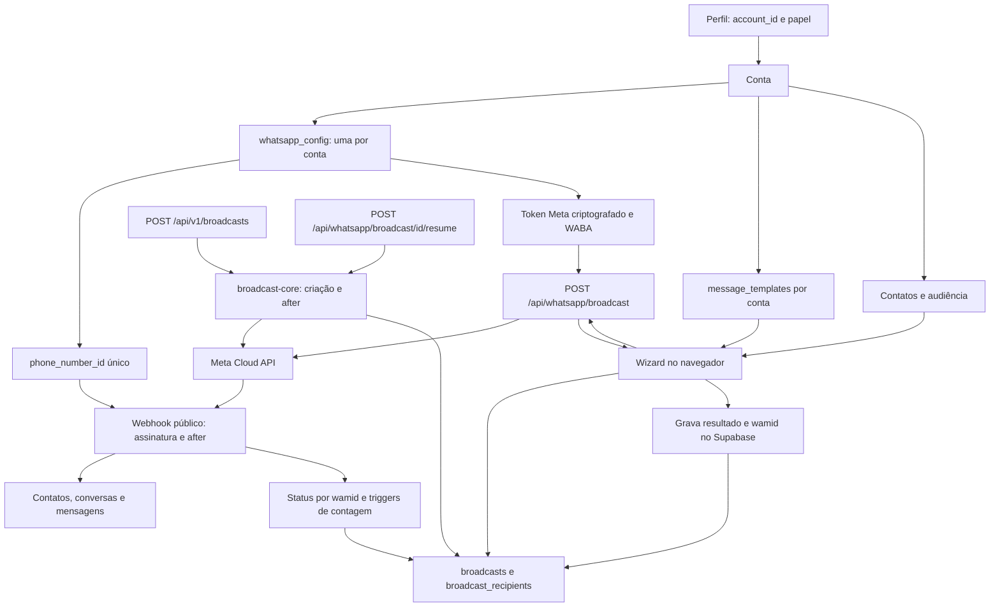

# Fase 0 — Baseline técnico

Data: 17/11/2026 (America/Sao_Paulo). Commit analisado: `6dbeb5bf94d4cf01be351272d0d45b64b1a684d4`.

**Registro posterior ao baseline:** após configuração local de credenciais e nova autorização do responsável, as 58 migrations existentes foram aplicadas ao projeto Supabase inicialmente vazio e a verificação de schema passou. O histórico abaixo preserva as condições da análise original; resultados de preparação do banco estão em `setup-and-credentials.md`, seção de atualização, e nos logs `migrations-apply.log`/`migrations-verify.log`. Nenhuma alteração arquitetural foi implementada.

## Escopo e conclusão

Leitura integral do PRD v0.1 disponibilizado em `C:/Users/Arq-Thaissa/Downloads/PRD_Plataforma_Castel_WhatsApp_v1.md`. O arquivo não estava na raiz deste checkout. Os requisitos são tratados como proposta de produto; a autorização desta execução é exclusivamente o diagnóstico da Fase 0. Nenhuma implementação das Fases 1–5, mudança de comportamento, migration remota ou envio real foi realizada.

O fork oferece uma base aproveitável de integração oficial Meta, autenticação, inbox, contatos, templates, campanhas e permissões. **Ainda não atende ao requisito central de campanhas persistentes independentes do navegador.** Existe recuperação manual no servidor, mas ela não equivale a uma fila durável. Criar o projeto Supabase também não comprova que o schema, Storage, Auth e Realtime necessários já estejam configurados.

## Verificações executadas

Ambiente: Windows/PowerShell, Node `v24.15.0`, npm `11.12.1`. `package.json` exige Node >=22.12.0 e declara npm 10.9.9; CI usa Node 22. Não houve alteração de lockfiles. Dependências instaladas por `npm ci --no-audit --no-fund`: 687 pacotes na aplicação e 96 no MCP. A instalação inicial encontrou EPERM no sandbox; a repetição autorizada fora dele concluiu. O MCP também exigiu repetição após erro interno do npm no sandbox. Não foi executada auditoria de vulnerabilidades de dependências.

| Comando | Resultado | Evidência |
|---|---|---|
| `npm test` | **Falhou**: 159 arquivos passaram, 1 falhou; 1.725 testes passaram e 3 falharam, de 1.728 | `baseline-logs/test.log` |
| `npm run lint` | Passou: 0 erros, **40 avisos** | `baseline-logs/lint.log` |
| `npm run typecheck` | Passou, inclusive repetido após geração de tipos no build | `baseline-logs/typecheck.log`, `typecheck-after-build.log` |
| `npm run build` | Primeira tentativa falhou ao baixar Inter; repetição com acesso à rede **passou**, gerando 53 páginas estáticas | `baseline-logs/build.log`, `build-network-retry.log` |
| `npm exec vitest run src/lib/currency.test.ts` | Reproduziu as mesmas 3 falhas isoladamente | `baseline-logs/currency-repro.log` |
| MCP: `npm run typecheck`, `npm run build` | Ambos passaram; módulo não possui scripts próprios de lint/teste | `baseline-logs/mcp-typecheck.log`, `mcp-build.log` |

Build com os placeholders da CI para URL/chave pública Supabase, chave de criptografia e segredo Meta. Esses valores foram definidos somente no processo de execução; não foram gravados como configuração funcional. Testes usam mocks; nenhum desses resultados valida conexão real com Supabase/Meta.

### Falhas e avisos preexistentes

- `src/lib/currency.test.ts:13,33,39`: espera `1,234`; `src/lib/currency.ts` usa `Intl.NumberFormat(undefined, ...)` e o locale efetivo deste Node/Windows é `pt-BR`, produzindo `1.234`. Fragilidade de portabilidade do teste; não é evidência de falha no envio WhatsApp. Correção futura: definir contrato de locale e tornar as expectativas determinísticas, sem impor formato americano ao produto brasileiro.
- `src/app/layout.tsx`: `next/font/google` exige download da Inter durante o build. A repetição com rede passou; registrar essa dependência na infraestrutura ou avaliar fonte local em mudança posterior.
- Next 16.3.8 avisa que `middleware.ts` e Edge Runtime estão depreciados. `src/middleware.ts` e rotas de imagem/metadados precisam de revisão futura conforme documentação instalada. Nenhum codemod executado.
- Lint: hooks com dependências incompletas, variáveis/imports não usados, imagens e navegação interna; inventário completo no log. Não rodar `--fix` durante o baseline.
- `npm run start` iniciou em `127.0.0.1:3100`, mas avisou sobre `output: standalone`; o entrypoint de implantação standalone é `.next/standalone/server.js`, com assets conforme Dockerfile. Partida do processo não comprova operação do CRM autenticado.
- O smoke HTTP local não foi concluído: o sandbox bloqueou o socket e a repetição fora dele terminou em timeout de conexão. Não há evidência HTTP de login ou de rejeição 401 nesta execução. O servidor temporário foi encerrado; não ficou aplicação conectada ao banco remoto.
- O exemplo de ambiente aponta para `docs/automations-and-cron.md`, que não existe neste checkout. As rotas reais de cron estão em `src/app/api/{automations,flows}/cron/route.ts`.

### Limites da validação

Não havia `.env.local`, conexão remota configurada nem comandos `docker`, `supabase` ou `psql` disponíveis no PATH. As 58 migrations SQL foram inventariadas e as cadeias relevantes revisadas estaticamente; replay SQL e testes reais de RLS **não foram executados**. Há workflow para isso em `.github/workflows/migrations.yml` e assertions em `supabase/ci/verify-schema.sql`; sua existência não prova execução bem-sucedida. Os intervalos ausentes na numeração dos arquivos não devem ser preenchidos por suposição.

As únicas adições ao checkout são os dois relatórios e os logs em `docs/architecture/`; os diretórios de dependências/build são artefatos locais ignorados pelo Git. Não houve commit ou publicação.

## Arquitetura existente

- Monólito Next.js 16.3.8/App Router, React 19.2.4, TypeScript 6, Tailwind 4, next-intl; UI e handlers HTTP no mesmo deploy. Scripts em `package.json`; testes Vitest 5.1.0 em `src/**/*.test.ts(x)`.
- Supabase Postgres, Auth, Storage e Realtime. Navegador acessa tabelas via cliente público e RLS (`src/lib/supabase/client.ts`); servidor com sessão usa `src/lib/supabase/server.ts`. Webhook, API pública e engines usam clientes service-role e precisam garantir escopo explicitamente.
- `src/hooks/use-auth.tsx`, `src/lib/auth/account.ts`, `roles.ts`: sessão, conta e hierarquia `owner > admin > agent > viewer`. `requireRole('agent')` protege envio; admin configura integração.
- `profiles.account_id` e `account_role` representam uma associação corrente por usuário. Não há modelo geral de múltiplas memberships, departamentos ou permissão por canal.
- `mcp-server/` é aplicação TypeScript separada, opcional, cliente da API `/api/v1`. Não é o motor de campanhas.
- `Dockerfile`, `docker-compose.yml` e `next.config.ts` cobrem hospedagem da aplicação; não há serviço dedicado de worker de campanhas ou Redis configurado.
- Licença raiz e pacote MCP: MIT, copyright Arnas Donauskas. Preservar avisos. Isto não substitui inventário jurídico/licenças de todos os pacotes transitivos.

## Dados e autorização

| Domínio | Tabelas principais | Migrations/pontos importantes |
|---|---|---|
| Identidade/conta | `profiles`, `accounts`, `account_invitations`, `member_presence` | 001, 017–020, 024, 034, 047, 055; `is_account_member` e RPCs de membros |
| Contatos | `contacts`, `tags`, `contact_tags`, `custom_fields`, `contact_custom_values`, `contact_notes` | 001, 017, 022, 025, 040; telefone normalizado único por conta e identidade BSUID |
| Atendimento | `conversations`, `messages`, `message_reactions`, `quick_replies`, `notifications` | 001, 009, 023, 027, 035–037, 039, 042, 048, 054, 060 |
| Integração Meta | `whatsapp_config`, `message_templates` | 013–015, 017, 039, 057; número globalmente único, configuração única por conta, templates únicos por conta/nome/idioma |
| Campanhas | `broadcasts`, `broadcast_recipients` | 003/005 contadores; 004 contato pode ser removido; 037/041/049 criação atômica; 038 parâmetros/lock; 058 lease do wizard |
| CRM comercial | `pipelines`, `pipeline_stages`, `deals` | 001/002, 017, 021 |
| Automações/fluxos | `automations`, `automation_steps`, `automation_logs`, `automation_pending_executions`, `flows`, `flow_nodes`, `flow_runs`, `flow_run_events` | 006/007, 010/012, 045, 051/052, 058 |
| API e integrações | `api_keys`, `webhook_endpoints`, `pending_message_statuses` | 026/028, 054; último é buffer de status de mensagens, não inbox durável de eventos brutos |
| IA opcional | `ai_configs`, `ai_knowledge_documents`, `ai_knowledge_chunks`, `ai_usage_log` | 029–033, 046, 053; busca textual e pgvector |

RLS da migration 017 dá leitura aos membros; escrita operacional a agent+, configuração a admin+. Filhos como mensagens/destinatários herdam escopo por joins aos pais. Revisar também correções posteriores de grants, integridade e Storage (043/044/047/055). Tokens são criptografados com AES-256-GCM em `src/lib/whatsapp/encryption.ts`; isso não elimina a necessidade de limitar leitura de ciphertext e proteger a chave fora do banco.

Não há tabelas do PRD para organizações/departamentos/canais, tickets/SLA/CSAT, ocorrências, conectores UAU, supressão/consentimento e fila de campanhas. Notas de contatos e deals podem apoiar o CRM, mas não equivalem a esses modelos.

## Dependências entre campanhas, contas, números e webhooks

1. **UI:** `src/app/(dashboard)/broadcasts/new/page.tsx` → quatro componentes `src/components/broadcasts/step*.tsx` → `src/hooks/use-broadcast-sending.ts`. Resolve audiência/CSV/campos, insere campanha e destinatários em operações separadas, congela parâmetros de corpo, adquire/renova lease e envia lotes de 10 com pausa de 1 s. O navegador recebe resultados, grava `wamid`/status e finaliza campanha. Fechar a aba pode interromper tanto novos envios quanto a gravação do resultado de envios já aceitos.
2. **Rota de lote:** `src/app/api/whatsapp/broadcast/route.ts` verifica sessão/papel, busca `whatsapp_config` por `account_id` com `.single()`, decripta token, resolve template e chama `sendTemplateMessage`. **Não persiste resultados.** O payload não carrega identidade de destinatário/job para claim atômico no servidor.
3. **API pública:** `src/app/api/v1/broadcasts/route.ts` autentica chave com escopo `broadcasts:send`. `src/lib/whatsapp/broadcast-core.ts` usa RPC transacional de criação (versão atual 049), dedupe e até 1.000 destinatários; faz fan-out sequencial em `after()`, limite declarado de 60 s. Persiste no servidor, mas não se recupera automaticamente após queda.
4. **Retomada:** `src/app/api/whatsapp/broadcast/[id]/resume/route.ts` e `broadcast-resume.ts` claimam a campanha e reprocessam pending/failed/all, até 1.000 por passagem, em `after()` com máximo declarado de 300 s. Restante exige nova ação. Lock de retomada fica stale após 30 min; lease do wizard dura 5 min (038/058). São proteções úteis, não claims duráveis por destinatário com fencing.
5. **Meta:** `src/lib/whatsapp/meta-api.ts`, `template-send-builder.ts`, `template-body.ts`, `phone-utils.ts` centralizam Graph API oficial, templates/mídia, idioma, normalização e erros. API fixada em `v21.0`; suporte e compatibilidade precisam ser validados contra a Meta antes de homologação, sem presumir que deva ser trocada nesta fase. O fetch de envio não define timeout explícito.
6. **Webhook:** `src/app/api/whatsapp/webhook/route.ts` valida challenge usando verify token criptografado; valida POST HMAC do corpo bruto (`webhook-signature.ts`, `webhook-body.ts`), responde 200 e só então processa em `after()` com limite de 60 s. Número resolve conta; mensagens alimentam inbox, automações, flows, IA e webhooks de saída. Lifecycle de templates é tratado por `template-webhook.ts` com WABA/ID do template.
7. **Status:** `broadcast-recipient-webhook.ts` correlaciona por `whatsapp_message_id`, limita transições para não regredir e atualiza contadores por trigger. `message-status-sync.ts`/054 estacionam status precoces para `messages`; não há replay equivalente para `broadcast_recipients` depois de gravar o wamid. Resposta à campanha é atribuída ao último destinatário do contato em janela de 7 dias: é heurística, não causalidade garantida.

O guia local `node_modules/next/dist/docs/01-app/03-api-reference/04-functions/after.md` confirma que `after()` está sujeito à duração da rota/plataforma; o comentário do webhook sobre conclusão garantida deve ser interpretado dentro desse limite.

### Acoplamentos para futuro multinúmero

`017_account_sharing.sql` impõe `UNIQUE(account_id)` em `whatsapp_config`; `013` impõe unicidade de `phone_number_id`. Os remetentes atuais são escolhidos implicitamente pela conta em broadcast/core/resume, `src/app/api/whatsapp/send/route.ts`, `src/lib/whatsapp/send-message.ts`, `src/lib/automations/meta-send.ts` e `src/lib/flows/meta-send.ts`; IA usa o caminho de envio compartilhado. Configuração/health/media/templates também precisam receber contexto de canal. `036` torna a conversa única por conta/contato: isso deve ser revisto antes de permitir dois números conversarem com o mesmo contato. Tipos em `src/types`, auth em `use-auth` e assinatura/roteamento de templates também entram no inventário da Fase 2. Não basta remover a restrição SQL.

## Riscos e decisões necessárias

| Prioridade | Evidência concreta | Consequência/decisão |
|---|---|---|
| P0 | Lote não grava no servidor; wizard grava depois | Queda entre aceite Meta e persistência perde correlação e pode duplicar no retry |
| P0 | `deliverBroadcast` envia e depois atualiza DB; não trata todos os erros de persistência | Mesmo worker precisa de ledger de tentativas e recuperação, não apenas mover o loop |
| P0 | `failed` inclui falha de rede/timeout; botão de retry pode reenviar | Introduzir `unknown`, revisão/reconciliação e política explícita; não prometer exactly-once externo |
| P0 | Webhook responde 200 antes de persistir evento durável | Crash após ack pode perder evento; gravar inbox de eventos antes do ack e processar com retry |
| P0 | Status pode chegar antes da gravação do wamid do destinatário | Guardar/reaplicar eventos de campanhas; buffer atual de mensagens não cobre esse caminho |
| P0 | `sent` é gravado assim que Meta retorna `messageId` | Distinguir `accepted_by_meta`, `sent`, `delivered` e `read` em estados/contadores/UI |
| P0 | `applyBroadcastRecipientStatus` usa service-role e filtra apenas wamid | Tornar escopo por conta/canal explícito; índice global não substitui autorização/roteamento |
| P0 | Sem supressão/consentimentos e política de elegibilidade persistentes | Não usar dados reais de cobrança antes de definir revalidação e bloqueios no servidor |
| P1 | `rate-limit.ts` é Map em memória; wizard limita por usuário, core sequencial não limita canal | Governador compartilhado por número/WABA, incluindo inbox, automações, flows e IA |
| P1 | Snapshot guarda corpo, mas retomada relê telefone atual e template local | Persistir telefone, componentes/header override, idioma e versão do template de maneira imutável |
| P1 | Criação do wizard não é transacional, diferentemente da API pública | Unificar criação/enfileiramento no backend e evitar campanhas parciais |
| P1 | Estado `scheduled`/coluna existem, sem scheduler de campanhas identificado | Não anunciar agendamento, pausa e cancelamento como implementados; definir semântica |
| P1 | Contadores usam `replied` no mesmo eixo de entrega | Rever métricas: resposta pode inflar leitura/entrega inferida; preferir eventos independentes |

Base reaproveitável: cliente Meta, criptografia, builder/validação de templates e erros, contatos/CSV/audiência, auth/RLS por conta, RPC transacional, correlação de wamid, transições de status, inbox/realtime, contadores e suíte de testes. Reaproveitar com evolução aditiva e homologação; não certificar produção a partir de testes mockados.

## Sequência proposta de implementação — nenhuma etapa abaixo executada

1. **Preparação/homologação:** preencher ambiente conforme `setup-and-credentials.md`; conferir schema remoto e executar migrations existentes em staging vazio com histórico correto; validar Auth/Storage/Realtime. Tornar teste monetário determinístico em PR próprio. Registrar baseline verde antes de mudar motor.
2. **Contrato do motor:** decidir hospedagem persistente, fila PostgreSQL versus Redis, estados, limites, recuperação de lease, política de timeout incerto e chave de dedupe. Proposta inicial: fila no Postgres para evitar outro serviço; Redis quando volume/concurrency justificar. Evitar migração ampla de tenancy nesta etapa; guardar remetente estável com caminho de evolução para canal.
3. **Schema aditivo:** novas migrations posteriores às existentes para jobs/tentativas/eventos, snapshot completo, claim/lease/fencing, `next_attempt_at`, limites de retry, dead-letter e status novos. Índices/unicidade/RLS/grants, backfill e rollback documentados; não renomear/apagar tabelas atuais.
4. **Worker:** novo pacote/entrypoint e módulos `src/lib/campaigns/` (caminhos propostos). Reaproveitar builders Meta; separar `broadcast-core.ts` em planejamento, uma tentativa de envio e persistência verificável. Supervisão/restart, shutdown, métricas, backoff com jitter e limites por canal; nunca serializar token decriptado no job/log.
5. **Um único caminho de execução:** rotas de lote/API pública/retomada passam a criar comandos/jobs e retornam IDs; autorização e snapshot no servidor. `use-broadcast-sending.ts` apenas solicita e acompanha. Atualizar `step4-schedule-send.tsx`, páginas de campanhas e tipos/status/traduções. Preservar cabeçalhos, botões e mídias existentes.
6. **Webhook durável e reconciliação:** adaptar `webhook/route.ts`, `broadcast-recipient-webhook.ts`, `message-status-sync.ts` e migrations de eventos para persistir/deduplicar antes do ack, escopar canal/conta, reaplicar eventos precoces e evitar regressão por gravação tardia do sender. Auditar efeitos de automações/flows/IA.
7. **Controle e aceite:** pausar/retomar/cancelar bloqueiam novos claims sem apagar aceites/eventos; testes de integração com DB real e Meta de teste autorizada. Fechar aba, reiniciar worker, lease expirado com dois workers, duas campanhas e inbox simultâneas, 429 upstream/local, queda antes/depois do aceite, falha de gravação, webhook duplicado/fora de ordem/antes do wamid e cancelamento durante envio. Tratar desconhecidos sem retry cego.
8. **Somente depois:** Fase 2 (organizações/departamentos/canais e testes RLS), Fase 3 (conector UAU após confirmação de API), Fases 4/5 (ocorrências, tickets, SLA e CSAT). Não incorporar UAU/UI nova ao PR do motor.

Decisões do responsável: onde hospedar worker/staging/HTTPS, fila e orçamento operacional, conta/número Meta de teste, política de revisão dos `unknown`, limites e concorrência, consentimento/supressão/retenção, propriedade e compartilhamento de canais na Fase 2. As opções são propostas; nada foi provisionado.
